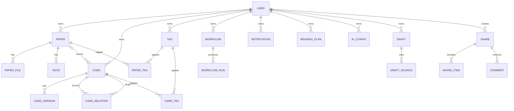

# 数据库概念设计（初版）

数据库为用户指定的 MySQL。下图描述概念关系，不是已执行的迁移；实体字段、具体外键、索引、字符集和删除策略需在详细设计中确定。图中关系基数表示概念约束，实际实现必须附加同用户归属验证。

## 实体范围

- 用户及认证会话：账户、密码哈希、设置与必要会话状态；认证细节待定。
- 文献、文件、笔记、文献状态变更：元数据、存储键、阅读笔记及统计所需事件。DOI 与标题规范化策略待定。
- 卡片、版本、关系、标签及关联表：允许来源文献为空；历史版本和关系拥有明确所有权，标签去重应按用户范围处理。
- 规则、事件、任务与执行记录：保存结构化规则、触发事件、执行键、状态和脱敏错误；实际唯一约束与事务机制待详细设计。
- 通知、阅读计划及计划关联：可记录进度和已读状态。周报可基于事实与事件查询生成；是否持久化生成记录待定。
- AI 配置、草稿及来源：配置归属用户，密钥仅存密文；来源明确关联用户选定的文献和卡片，并考虑源删除后的可追溯性。
- 分享、分享项和批注：仅包含明确选择的对象；访问时校验分享状态。快照/引用与源删除行为待定。

私有实体必须能追溯到所有者，跨资源关联必须验证同一所有者。文件清理、级联删除及草稿/分享来源保留的规则在详细设计完成前均未决；不推定 MySQL 外键本身能够自动保证所有业务授权。
