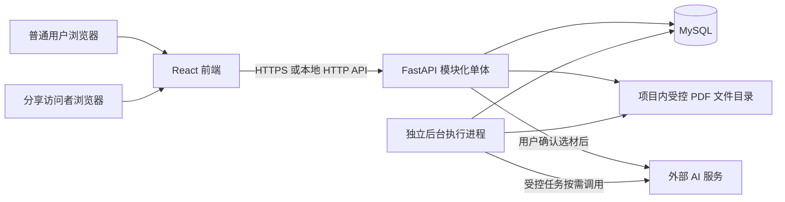

# 系统架构设计（初版）

状态：拟定，未实现及验证。建议使用 React、TypeScript、Vite、React Router、TanStack Query 和 Tailwind CSS；FastAPI、Pydantic、SQLAlchemy、Alembic 配合 MySQL。具体库版本、驱动和兼容性待核实。PDF、图谱、表单和图表库根据详细设计及验证选择。

图中均为计划组件，不代表已部署。后台进程和 API 使用同一业务代码与数据库；生产环境的 HTTPS、代理与拓扑不在当前本地交付范围。

## 组件职责

| 组件 | 职责 | 信任边界 |
| --- | --- | --- |
| 前端 | 页面导航、表单校验、PDF 阅读、图谱和数据状态展示 | 客户端输入不可信；不能承担最终授权 |
| API | 身份校验、资源授权、业务校验、事务与错误响应、文件授权、AI 代理 | 每次请求校验用户或分享令牌；日志不含秘密 |
| MySQL | 私有数据、规则事件/执行、任务状态和关系的持久化 | 数据库凭据外部配置；迁移版本化 |
| 文件目录 | 保存上传 PDF，数据库只保留受控存储键及必要元信息 | 不直接映射为公开目录；经权限检查后提供文件 |
| 后台进程 | 扫描持久任务/定时工作并记录结果 | 假设首版本地仅一个执行进程；重启恢复、幂等与竞争保护需设计验证 |
| 外部 AI | 根据用户明确选定材料返回生成结果 | 数据离开本地前提示；仅信任响应为未核实草稿 |

## 任务与可靠性边界

计划通过 MySQL 持久化事件和任务状态，单独进程扫描并执行；无需默认增加 Redis。业务写入与事件记录在同一事务中；数据库唯一约束、原子状态更新和事务保护同一执行键下的副作用。执行失败保存可安全展示的错误并可重试；网络 AI 请求可能发生重复外部调用，不能承诺外部服务的恰好一次执行，重试策略和用户反馈待详细设计。定时扫描可能因进程停止而延迟，恢复后补扫的时间范围和策略待设计。PDF 文件写入与数据库不是同一事务，需制定临时文件、失败清理及恢复策略。

## 安全与网络

私有接口和文件访问服务端强制校验归属；分享令牌独立于登录会话、服务端检查有效性和授权范围。对外部 AI 地址需约束允许协议及访问目标，防止服务端请求访问内部敏感地址；考虑用户自托管服务的本地部署需求，最终允许策略和配置方式待详细设计。限制输入、响应脱敏、日志过滤、上传和渲染防护须经测试。生产级安全与扩展能力不因这份设计而被视为已达成。
